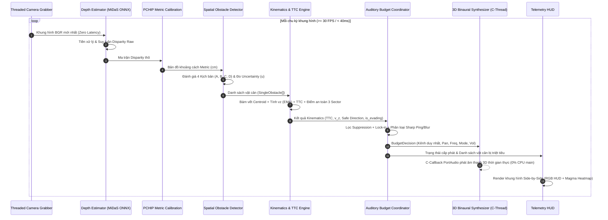

# HorusEyes 2.0 — Tài Liệu Đặc Tả & Phân Tích Cặn Kẽ Toàn Bộ Codebase

> **Đề tài NCKH KHKT (ViSEF 2026–2027):**  
> *"Khung điều phối ngân sách thính giác nhận thức độ bất định phục vụ hỗ trợ tránh va chạm thời gian thực tại biên"*  
> *(Uncertainty-Aware Auditory Budget Collision Avoidance System for Edge Platforms)*  
> **Ngôn ngữ triển khai:** Python 3.9+ (Core Research & Benchmark Pipeline) và Kotlin (Android Native Edge Application).

---

## MỤC LỤC TỔNG QUAN

1. [Tổng Quan Đề Tài & Mục Tiêu Kiến Trúc](#1-tổng-quan-đề-tài--mục-tiêu-kiến-trúc)
2. [Cấu Trúc Cây Thư Mục & Phân Hệ Chức Năng](#2-cấu-trúc-cây-thư-mục--phân-hệ-chức-năng)
3. [Phân Tích Cặn Kẽ Từng Module Python Lõi](#3-phân-tích-cặn-kẽ-từng-module-python-lõi)
   - [3.1. `config.py` — Quản Trị Siêu Tham Số Hệ Thống](#31-configpy--quản-trị-siêu-tham-số-hệ-thống)
   - [3.2. `video_capture.py` — Thu Nhận Video Đa Luồng Không Độ Trễ](#32-video_capturepy--thu-nhận-video-đa-luồng-không-độ-trễ)
   - [3.3. `depth_engine.py` — Suy Luận Độ Sâu & Spatial Engine v8](#33-depth_enginepy--suy-luận-độ-sâu--spatial-engine-v8)
   - [3.4. `motion_ttc.py` — Động Học Thời Gian Thực & Dự Báo Va Chạm (TTC)](#34-motion_ttcpy--động-học-thời-gian-thực--dự-báo-va-chạm-ttc)
   - [3.5. `auditory_budget.py` — Bộ Điều Phối Ngân Sách Thính Giác (Budget $\le$ 1 Stream)](#35-auditory_budgetpy--bộ-điều-phối-ngân-sách-thính-giác-budget--1-stream)
   - [3.6. `audio_synth.py` — Tổng Hợp Âm Thanh Không Gian 3D Binaural Non-Blocking](#36-audio_synthpy--tổng-hợp-âm-thanh-không-gian-3d-binaural-non-blocking)
   - [3.7. `telemetry_gui.py` — Trực Quan Hóa HUD Song Song (Side-by-Side)](#37-telemetry_guipy--trực-quan-hóa-hud-song-song-side-by-side)
   - [3.8. `main.py` — Nhạc Trưởng Điều Phối (Orchestrator Pipeline)](#38-mainpy--nhạc-trưởng-điều-phối-orchestrator-pipeline)
4. [Phân Hệ Kiểm Thử Tự Động & Benchmarking Khoa Học](#4-phân-hệ-kiểm-thử-tự-động--benchmarking-khoa-học)
   - [4.1. `diagnose_system.py` — Chẩn Đoán 10 Kịch Bản Biên Headless](#41-diagnose_systempy--chẩn-đoán-10-kịch-bản-biên-headless)
   - [4.2. `benchmark_master_suite.py` — Đánh Giá Đa Dữ Liệu NYU Depth V2 & TUM RGB-D](#42-benchmark_master_suitepy--đánh-giá-đa-dữ-liệu-nyu-depth-v2--tum-rgb-d)
   - [4.3. Các Kịch Bản Bổ Trợ (`test_pipeline.py`, `poc_demo.py`, `nyu_evaluator.py`...)](#43-các-kịch-bản-bổ-trợ)
5. [Phân Hệ Android Native (`android/` — 100% Kotlin)](#5-phân-hệ-android-native-android--100-kotlin)
   - [5.1. Kiến Trúc Kỹ Thuật Android Native Edge](#51-kiến-trúc-kỹ-thuật-android-native-edge)
   - [5.2. Đối Ứng Mã Nguồn (Parity) Giữa Python và Kotlin](#52-đối-ứng-mã-nguồn-parity-giữa-python-và-kotlin)
6. [Mô Hình Toán Học & Cơ Sở Lý Thuyết Cốt Lõi](#6-mô-hình-toán-học--cơ-sở-lý-thuyết-cốt-lõi)
   - [6.1. Nội Suy Đơn Điệu PCHIP Fritsch-Carlson](#61-nội-suy-đơn-điệu-pchip-fritsch-carlson)
   - [6.2. Lý Thuyết Biến Thiên Quang Học & Tau Margin ($TTC$) Của Lee](#62-lý-thuyết-biến-thiên-quang-học--tau-margin-ttc-của-lee)
   - [6.3. Hàm Điểm An Toàn Đa Yếu Tố Cho Hành Lang (Sector Safety Score)](#63-hàm-điểm-an-toàn-đa-yếu-tố-cho-hành-lang-sector-safety-score)
   - [6.4. Âm Học Song Nhĩ 3D Binaural (Woodworth ITD & ILD Filter)](#64-âm-học-song-nhĩ-3d-binaural-woodworth-itd--ild-filter)
7. [Luồng Dữ Liệu Thời Gian Thực (Pipeline Data Flow)](#7-luồng-dữ-liệu-thời-gian-thực-pipeline-data-flow)
8. [Hướng Dẫn Cài Đặt, Vận Hành & Khai Thác](#8-hướng-dẫn-cài-đặt-vận-hành--khai-thác)

---

## 1. TỔNG QUAN ĐỀ TÀI & MỤC TIÊU KIẾN TRÚC

HorusEyes 2.0 là hệ thống hỗ trợ người khiếm thị tránh va chạm theo thời gian thực hoạt động hoàn toàn trên thiết bị biên (Edge Computing). Khác với các hệ thống trợ thị truyền thống vốn gặp phải 3 vấn đề lớn:
1. **Quá tải nhận thức thính giác (Auditory Cognitive Overload):** Phát âm thanh liên tục, bíp hỗn loạn khi gặp nhiều vật thể, gây căng thẳng và che lấp âm thanh môi trường xung quanh của người khiếm thị.
2. **Độ trễ cao và nghẽn hệ thống:** Dùng mô hình thị giác máy tính quá nặng hoặc cơ chế phát âm thanh blocking làm gián đoạn vòng lặp xử lý camera.
3. **Cảnh báo sai (False Alarms) từ các bề mặt vô hại:** Báo động giả trên trần nhà, mặt sàn, hoặc tường phẳng của phòng trống.

HorusEyes 2.0 giải quyết triệt để các vấn đề trên thông qua:
- **Ngân sách thính giác cực hạn ($Budget \le 1$ stream):** Ràng buộc cứng chỉ cấp phát duy nhất 1 luồng âm thanh cho mối nguy khẩn cấp nhất, triệt tiêu 100% âm thanh khi hành lang an toàn.
- **Nhận thức rủi ro động học và độ bất định AI (Uncertainty-Aware):** Phân tích $TTC$ kết hợp đo đạc độ tin cậy của bản đồ độ sâu để biến điệu âm thanh giữa xung sắc nét (`SHARP_PING`) và nhòe âm (`ACOUSTIC_BLUR`).
- **Dẫn hướng né tránh thông minh (Safe-Direction Guidance):** Tính toán điểm an toàn của 3 sector hành lang, phát hiện phản xạ né tránh của người dùng để giảm 50% âm lượng (`Closed-Loop Hysteresis`).
- **Tổng hợp âm thanh 3D Binaural không gián đoạn (Non-blocking PortAudio / AudioTrack):** Chạy trên luồng C của driver phần cứng âm thanh, 0% CPU overhead trên vòng lặp camera.

---

## 2. CẤU TRÚC CÂY THƯ MỤC & PHÂN HỆ CHỨC NĂNG

```
e:\visef27 project/
│
├── requirements.txt            # Danh sách dependencies (OpenCV, PyTorch, SoundDevice, SciPy, ONNXRuntime)
├── config.py                   # Cấu hình siêu tham số, mốc PCHIP, ngưỡng khoảng cách và âm học
├── video_capture.py            # Grabber camera đa luồng triệt tiêu độ trễ hàng đợi
├── depth_engine.py             # MiDaS ONNX/PyTorch + Nội suy PCHIP Spline + Spatial Engine v8
├── motion_ttc.py               # Centroid Tracker + Tính vận tốc tiếp cận v_z + TTC + Safe Direction
├── auditory_budget.py          # Bộ điều phối ngân sách thính giác (Budget <= 1 stream, Hysteresis Lock-in)
├── audio_synth.py              # Bộ tổng hợp 3D Binaural (PortAudio C-callback, ITD, ILD, Low-pass)
├── telemetry_gui.py            # Render giao diện Side-by-Side (RGB HUD + Depth Heatmap)
├── main.py                     # Nhạc trưởng điều phối toàn bộ pipeline thời gian thực
│
├── diagnose_system.py          # Bộ kiểm thử chẩn đoán tự động 10 kịch bản biên không cần webcam
├── benchmark_master_suite.py   # Benchmark tự động toàn diện trên NYU Depth V2 & TUM Dynamic
├── benchmark_nyu_pipeline.py   # Kịch bản benchmark chuyên sâu trên tập dữ liệu NYU Depth V2
├── benchmark_tum_motion.py     # Kịch bản benchmark chuyên sâu động học TUM RGB-D
├── test_pipeline.py            # Unit test tích hợp 6 module chức năng
├── test_horuseyes_benchmark.py # Đo đạc hiệu năng và phân loại trên ảnh thực nghiệm
├── poc_demo.py                 # Bản thử nghiệm chứng minh khái niệm (Proof-of-Concept) tiền đề
│
├── midas_small_160.onnx        # Mô hình MiDaS tối ưu hóa ONNX Runtime (Input 160x160)
├── midas_small_192.onnx        # Mô hình MiDaS tối ưu hóa ONNX Runtime (Input 192x192)
├── midas_small_256.onnx        # Mô hình MiDaS tối ưu hóa ONNX Runtime (Input 256x256)
│
├── android/                    # Phân hệ Android Native (100% Kotlin + ONNX Runtime Mobile)
│   ├── app/src/main/
│   │   ├── AndroidManifest.xml # Cấu hình quyền camera & tối ưu phần cứng di động
│   │   ├── assets/             # Chứa mô hình midas_small.onnx tự đóng gói
│   │   └── java/com/horuseyes/app/
│   │       ├── Config.kt                         # Siêu tham số tương đồng 100% với config.py
│   │       ├── math/PchipInterpolator.kt         # Thuật toán PCHIP Fritsch-Carlson bằng Kotlin
│   │       ├── vision/DepthEngine.kt             # ONNX Runtime MiDaS & Phân đoạn không gian v8
│   │       ├── vision/CameraAnalyzer.kt          # CameraX zero-latency analyzer
│   │       ├── kinematics/KinematicsEngine.kt    # Tracker & Tính toán TTC cho thiết bị di động
│   │       ├── budget/AuditoryBudgetManager.kt   # Ngân sách thính giác & Lock-in
│   │       ├── audio/SpatialAudioEngine.kt       # 3D Binaural AudioTrack MODE_STREAM
│   │       ├── ui/OverlayView.kt                 # HUD Canvas hiển thị thông số thời gian thực
│   │       └── MainActivity.kt                   # Quản lý vòng đời và điều phối luồng Android
│   └── export_onnx.py          # Script xuất mô hình PyTorch sang ONNX cho Android
│
├── reports/                    # Báo cáo thực nghiệm khoa học, đồ thị phân rã sai số & số liệu
│   ├── Bao_Cao_Ky_Thuat_Moi_HorusEyes_2.0.md
│   ├── full_benchmark_tum_nyu_report.md
│   ├── tum_motion_benchmark.md
│   └── *.png (Biểu đồ sai số, PCHIP Spline Curve, TUM Telemetry...)
└── README.md                   # Hướng dẫn nhanh cài đặt và sử dụng
```

---

## 3. PHÂN TÍCH CẶN KẼ TỪNG MODULE PYTHON LÕI

### 3.1. `config.py` — Quản Trị Siêu Tham Số Hệ Thống

File `config.py` đóng vai trò là "single source of truth" (nguồn chân lý duy nhất) cho toàn bộ hệ thống Python:

- **Thông số hình ảnh & Camera:**
  - `CAM_WIDTH = 640`, `CAM_HEIGHT = 480`: Độ phân giải làm việc chuẩn.
  - `MAX_FRAME_WIDTH = 640`: Tự động co giãn ảnh đầu vào trước khi cấp cho mạng nơ-ron để bảo đảm throughput.
  - `CAM_INDICES_TO_TRY = [0, 1, 2]`: Cơ chế tự động dò tìm webcam máy tính khi người dùng không truyền tham số.
  - `CONNECTION_TIMEOUT = 5.0`: Giới hạn 5 giây khi kết nối stream IP camera mạng.

- **Hiệu chuẩn độ sâu Metric Monotonic (PCHIP Spline):**
  - `CALIBRATION_NODES`: Danh sách 11 mốc hiệu chuẩn (disparity raw, distance cm) nội suy từ thực nghiệm và tập dữ liệu NYU Depth V2:
    - `(135.0, 350.0)` $\rightarrow$ 3.5m (Hành lang sâu / vô cực)
    - `(295.0, 200.0)` $\rightarrow$ 2.0m (Cửa ra vào xa)
    - `(375.0, 150.0)` $\rightarrow$ 1.5m (Ngưỡng lưu ý)
    - `(505.0, 100.0)` $\rightarrow$ 1.0m (Cánh cửa, bậc thềm)
    - `(650.0, 50.0)` $\rightarrow$ 50cm (Bức tường, tay vịn)
    - `(800.0, 30.0)` $\rightarrow$ 30cm (Ngưỡng nguy hiểm DANGER)
    - `(1200.0, 13.0)` $\rightarrow$ 13cm (Bão hòa cực hạn / Chạm mắt kính)

- **Ngưỡng khoảng cách vật lý ($cm$):**
  - `DIST_CRITICAL_CM = 15.0`: Khẩn cấp cao nhất.
  - `DIST_DANGER_CM = 30.0`: Nguy hiểm va chạm tĩnh.
  - `DIST_WARNING_CM = 70.0`: Cảnh báo trung gian.
  - `DIST_ALERT_CM = 150.0`: Vùng lưu ý.
  - `DIST_SAFE_CM = 250.0`: An toàn tuyệt đối, triệt tiêu âm thanh.

- **Mặt nạ hình học (Geometric Masking):**
  - `TOP_MASK_RATIO = 0.15`: Cắt bỏ 15% đỉnh ảnh để loại bỏ trần nhà và bóng đèn.
  - `BOTTOM_MASK_RATIO = 0.15`: Cắt bỏ 15% đáy ảnh để loại bỏ bàn chân và nền sàn cận cảnh.

- **Bộ lọc chống báo ảo phòng trống & Bão hòa thấu kính:**
  - `BASE_ACTIVATION_RAW = 450.0`, `BASE_ACTIVATION_PEAK = 520.0`: Nếu phân vị 95 của disparity trung tâm dưới 450.0, hệ thống xác nhận phòng trống và giữ im lặng.
  - `SATURATION_RAW_THRESHOLD = 800.0`, `SATURATION_CENTER_RATIO = 0.25`: Nếu disparity $\ge 800$ chiếm $>25\%$ vùng trung tâm, kích hoạt cảnh báo bão hòa cận sát thấu kính (<15cm).

- **Động học TTC & Ngân sách âm học:**
  - `TTC_CRITICAL = 0.8s`, `TTC_WARNING = 2.0s`, `TTC_SAFE = 3.5s`.
  - `MOTION_DISP_THRESHOLD_CM = 12.0cm`, `MIN_NET_DISPLACEMENT_CM = 8.0cm`: Lượng biến thiên tối thiểu để phân biệt vật đang di chuyển với nhiễu rung lắc camera.
  - `VZ_DEADBAND_CM_S = 20.0cm/s`: Vùng chết vận tốc triệt tiêu nhiễu dao động cảm biến.
  - `MAX_ACTIVE_STREAMS = 1`: Ràng buộc ngân sách cứng tối đa 1 stream.
  - `UNCERTAINTY_BLUR_THRESHOLD = 0.45`: Ngưỡng chuyển đổi giữa Sharp Ping và Acoustic Blur.

---

### 3.2. `video_capture.py` — Thu Nhận Video Đa Luồng Không Độ Trễ

Module đảm bảo việc thu nhận khung hình từ camera độc lập với luồng suy luận AI chính, giải quyết triệt để vấn đề "lag giật do buffer tích lũy" (buffer bloat).

- **`ThreadedCamera` Class:**
  - Khởi tạo một thread daemon chuyên biệt (`threading.Thread`) chỉ làm một việc duy nhất: liên tục gọi `cap.read()` để xả sạch hàng đợi buffer của driver video.
  - Biến cờ `self.stopped` và khóa `threading.Lock` bảo vệ khung hình mới nhất (`self.frame`).
  - Hàm `read()` trả về bản sao khung hình mới nhất tức thời với độ trễ $\approx 0$ ms.
- **Hỗ trợ đa nguồn & Tự động thích ứng:**
  - Tự động nhận diện index camera (`0, 1, 2`) hoặc chuỗi URL stream (`http://`, `https://`, `rtsp://`).
  - Trên hệ điều hành Windows, tự động ưu tiên backend `cv2.CAP_DSHOW` (DirectShow) giúp mở camera tức thời không bị đơ.
  - Tích hợp timeout an toàn (`CONNECTION_TIMEOUT = 5.0s`), ngăn ngừa chương trình bị treo vô hạn nếu camera mạng bị mất kết nối.
  - Tự động thu nhỏ khung hình (Downsampling) nếu kích thước lớn hơn `MAX_FRAME_WIDTH` (640px) để duy trì tốc độ xử lý cao.

---

### 3.3. `depth_engine.py` — Suy Luận Độ Sâu & Spatial Engine v8

Đây là module chịu trách nhiệm ước lượng độ sâu đơn mục kính và phân đoạn vật cản 3D, kế thừa và nâng cấp toàn diện từ `poc_demo.py`.

- **Bộ suy luận độ sâu tăng tốc (`DepthEstimator`):**
  - Tự động dò tìm các mô hình ONNX đã được lượng tử hóa/tối ưu (`midas_small_160.onnx`, `midas_small_192.onnx`).
  - Sử dụng **ONNX Runtime** với cấu hình đa luồng CPU (`intra_op_num_threads = 4..6`, `ORT_ENABLE_ALL`), hạ độ trễ suy luận xuống dưới **40ms** trên CPU thông thường.
  - Cung cấp cơ chế dự phòng tự động (Fallback) về PyTorch Hub (`intel-isl/MiDaS`) nếu không tìm thấy ONNX Runtime.

- **Nội suy độ sâu đơn điệu PCHIP (`PchipInterpolator` & `compute_metric_distance_cm`):**
  - Tự động tích hợp bản cài đặt thuần NumPy của thuật toán **Fritsch-Carlson PCHIP (1980)** để không phụ thuộc vào thư viện nặng `scipy`.
  - Đảm bảo ánh xạ từ disparity raw sang khoảng cách $cm$ luôn đơn điệu giảm nghiêm ngặt: Disparity càng lớn $\rightarrow$ Khoảng cách càng gần.
  - Triệt tiêu hoàn toàn hiện tượng ngoại suy vọt lố (Runge's phenomenon / overshoot) vốn xuất hiện ở Cubic Spline thông thường.
  - Kẹp biên an toàn trong dải $[13.0\,\text{cm}, 350.0\,\text{cm}]$, miễn nhiễm hoàn toàn với các giá trị `NaN`, `Inf` hoặc khoảng cách âm.

- **Nhận diện vật cản không gian 4 kịch bản (Spatial Engine v8):**
  1. **Kịch bản A (Lens Saturation — Vật cản áp sát thấu kính):**
     - Khi bàn tay hoặc vật cản che sát camera ($<15\,\text{cm}$), disparity bão hòa ở mức cực đại ($\ge 800$).
     - Nếu tỷ lệ pixel bão hòa $>25\%$ ở trung tâm hoặc $>60\%$ toàn khung hình $\rightarrow$ Kích hoạt ngay trạng thái `CRITICAL_SATURATED`, cự ly $13.0\,\text{cm}$, độ bất định thấp ($0.05$).
  2. **Kịch bản B (Clear Path — Phòng trống / Hành lang thông suốt):**
     - Khảo sát phân vị 95 vùng trung tâm và phân vị 98 toàn cảnh. Nếu raw disparity thấp ($< 450.0$) $\rightarrow$ Xác nhận không có vật cản gần, trả về nhãn `SAFE (Clear Path >150cm)` và triệt tiêu âm thanh.
  3. **Kịch bản C (Discontinuity Step & Sobel Border Gradient):**
     - Áp dụng mặt nạ hình học cắt bỏ 15% trần và 15% sàn.
     - Sử dụng toán tử Sobel tính gradient biên kết hợp độ chênh lệch bước nhảy độ sâu cục bộ (`DISCONTINUITY_STEP_MIN = 0.16`).
     - Phát hiện chính xác các vật cản nhỏ, mỏng nổi bật trên nền (ngón tay, cây gậy, chai nước, người đi bộ).
  4. **Kịch bản D (Corridor Planar Wall — Vách tường phẳng / Cánh cửa):**
     - Đánh giá độ biến thiên bề mặt vùng trung tâm (`corr_std < 32.0`) kết hợp phân tích kênh màu HSV (`h_std < 12.0`).
     - Phân biệt chính xác giữa vách tường phía trước cần cảnh báo và trần nhà phía trên (`Overhead Ceiling`) để tránh báo động giả khi người dùng ngửa đầu lên trần.

- **Đo lường chỉ số bất định nhận thức AI (`uncertainty_score`):**
  - Đánh giá độ không chắc chắn dựa trên phương sai phần dư nhiễu sau khi làm mịn Gaussian (`noise_residual`) và độ tương phản viền của vật cản.
  - Giá trị $u \in [0.0, 1.0]$ phản ánh mức độ tin cậy của bản đồ độ sâu tại vùng phát hiện.

---

### 3.4. `motion_ttc.py` — Động Học Thời Gian Thực & Dự Báo Va Chạm (TTC)

Module tính toán động học tiếp cận và dự báo va chạm siêu nhẹ với thời gian thực thi $< 0.2$ ms trên CPU.

- **Lightweight Centroid & IoU Tracker (`LightweightCentroidTracker`):**
  - Duy trì định danh (ID) ổn định cho từng vật cản qua các khung hình liên tiếp.
  - Kết hợp khoảng cách Euclidean giữa các tâm (Centroid) với chỉ số tương đồng hộp bao (Intersection over Union - IoU).
  - Tích hợp bộ nhớ trễ (`max_missing = 4 frames`) để duy trì track khi vật cản bị nhòe chuyển động (motion blur) trong tích tắc.

- **Ước lượng vận tốc tiếp cận $v_z$ và lọc nhiễu:**
  - Lưu trữ cửa sổ trượt lịch sử khoảng cách ($N = 8$ frames $\approx 0.27$s).
  - Áp dụng phương pháp hồi quy tuyến tính cục bộ (Windowed Linear Regression) trên cặp dữ liệu $(t_i, d_i)$ để ước tính vận tốc tức thời thô $v_{z\_raw} = -\frac{\Delta d}{\Delta t}$.
  - Làm mịn vận tốc bằng bộ lọc Exponential Moving Average (EMA) với $\alpha = 0.40$:
    $$v_{z\_smooth}(t) = \alpha \cdot v_{z\_raw}(t) + (1 - \alpha) \cdot v_{z\_smooth}(t-1)$$
  - Áp dụng vùng chết vận tốc (`VZ_DEADBAND_CM_S = 20.0 cm/s`): Nếu $|v_z| < 20.0\,\text{cm/s}$, coi như vật thể đang đứng yên tương đối ($v_z = 0$).

- **Tính toán Time-to-Collision (TTC):**
  - Dựa trên lý thuyết biến thiên quang học Tau Margin của Lee:
    $$TTC = \begin{cases} \dfrac{Z}{v_z} & \text{khi } v_z \ge 25.0\,\text{cm/s} \text{ và } \Delta d_{net} \ge 8.0\,\text{cm} \\ +\infty & \text{khi } v_z < 25.0\,\text{cm/s (đứng yên hoặc lùi ra xa)} \end{cases}$$
  - Phân cấp đe dọa thành 3 cấp bậc:
    - **CRITICAL:** $TTC \le 0.8\,\text{s}$ hoặc $Z \le 30\,\text{cm}$.
    - **WARNING:** $0.8\,\text{s} < TTC \le 2.0\,\text{s}$ hoặc $30\,\text{cm} < Z \le 70\,\text{cm}$.
    - **SAFE:** $TTC > 2.0\,\text{s}$ và $Z > 150\,\text{cm}$.

- **Dẫn hướng né thoát an toàn (Risk-Aware Safe Path Guidance):**
  - Khảo sát 3 sector: TRÁI (LEFT), GIỮA (CENTER), PHẢI (RIGHT).
  - Tính điểm an toàn tổng hợp cho từng sector:
    $$Score_{sector} = w_1 \cdot S_{clearance} - w_2 \cdot S_{ttc\_threat} - w_3 \cdot S_{velocity\_penalty}$$
    với $w_1 = 0.50$ (độ thông thoáng), $w_2 = 0.35$ (phạt rủi ro TTC), $w_3 = 0.15$ (phạt vận tốc tiếp cận).
  - Tích hợp biên độ trễ (`SECTOR_HYSTERESIS_MARGIN = 0.10`): Chỉ đổi hướng né khi sector mới vượt trội hơn sector cũ ít nhất 10% điểm số, ngăn chặn hiện tượng rung lắc hướng dẫn.
  - Nếu cả hai hướng thoát đều bị bế tắc ($Z < 40\,\text{cm}$, clearance $< 0.08$) $\rightarrow$ Báo động dừng khẩn cấp (`STOP / HAZARD_BLOCKED`).

- **Phát hiện phản xạ né tránh (Evasion Motion Detection):**
  - Theo dõi sự dịch chuyển tâm góc của vật cản đối chiếu với hướng dẫn né.
  - Nếu người dùng đã bắt đầu né về hướng an toàn duy trì liên tục trong $\ge 4$ khung hình $\rightarrow$ Kích hoạt cờ `is_evading = True`.

---

### 3.5. `auditory_budget.py` — Bộ Điều Phối Ngân Sách Thính Giác (Budget $\le$ 1 Stream)

Module trung tâm điều tiết nhận thức thính giác của người dùng, ngăn ngừa hiện tượng mỏi tai và bảo vệ thính giác.

- **Ràng buộc cứng $Budget \le 1$ Stream:**
  - Dù phía trước có bao nhiêu vật cản đồng thời, hệ thống chỉ cấp phát **duy nhất 1 luồng âm thanh** cho mục tiêu có điểm đe dọa (Threat Score) cao nhất.
  - Tất cả các vật cản phụ còn lại đều bị đưa vào danh sách triệt tiêu âm thanh (`suppressed_obstacles`).

- **Cơ chế Triệt Tiêu Hoàn Toàn (Total Auditory Suppression):**
  - Giữ im lặng tuyệt đối (`cue_mode = "MUTED"`, `is_active = False`) khi môi trường an toàn ($Z > 250\,\text{cm}$ hoặc $TTC > 2.0\,\text{s}$ và $Z > 150\,\text{cm}$).
  - Trả lại 100% không gian thính giác tự nhiên để người khiếm thị nghe tiếng gậy, tiếng xe cộ và âm thanh xung quanh.

- **Cơ chế chống giằng co luồng âm (Hysteresis Lock-in):**
  - Nếu hai vật cản có mức độ đe dọa xấp xỉ nhau, việc chuyển đổi luồng âm liên tục sẽ gây ra hiện tượng giật cục (thrashing / chattering).
  - HorusEyes 2.0 áp dụng cơ chế:
    1. Thưởng $+15\%$ điểm ưu tiên (`HYSTERESIS_BOOST = 1.15`) cho vật cản đang nắm giữ stream âm thanh.
    2. Yêu cầu thời gian nắm giữ tối thiểu `MIN_HOLD_FRAMES = 5` frames.
    3. Vật cản mới muốn cướp quyền phát âm phải có điểm số vượt trội liên tục trong ít nhất `SWITCH_CONFIRM_FRAMES = 3` frames.

- **Mã hóa độ bất định âm học (Uncertainty Sonification):**
  - **`SHARP_PING` (Xung sắc nét):** Khi độ bất định $u < 0.45$, âm thanh phát ra dạng sóng sin thuần khiết, viền âm rõ ràng, báo hiệu vật cản đã được AI định vị chuẩn xác.
  - **`ACOUSTIC_BLUR` (Nhòe phổ âm học):** Khi độ bất định $u \ge 0.45$ (do bề mặt kính, phản quang, hoặc nhòe chuyển động), hệ thống tự động hòa trộn tạp âm trắng băng hẹp (Narrowband Noise) và điều chế tần số (FM jitter), cảnh báo người dùng cần thận trọng dò dẫm.

- **Điều tiết âm lượng vòng lặp kín (Closed-Loop Hysteresis):**
  - Khi cờ `is_evading = True` (người dùng đang chủ động né tránh theo đúng chỉ dẫn), hệ thống tự động hạ 50% âm lượng (`volume_factor = 0.50`), vừa duy trì tín hiệu định vị vừa giúp người dùng tập trung bước đi.

---

### 3.6. `audio_synth.py` — Tổng Hợp Âm Thanh Không Gian 3D Binaural Non-Blocking

Module chịu trách nhiệm biến các quyết định số học thành trải nghiệm âm thanh 3D sống động và chính xác tới từng mili-giây.

- **Kiến trúc Driver C-Callback (PortAudio Non-Blocking):**
  - Kế thừa trực tiếp ưu điểm kỹ thuật từ `poc_demo.py`.
  - Thay vì sử dụng các hàm blocking như `sd.play()` gây dừng vòng lặp chính, module sử dụng `sd.OutputStream` với hàm callback `_audio_callback`.
  - Hàm callback này được hệ điều hành kích hoạt trên luồng C độc lập của card âm thanh định kỳ mỗi block (1024 mẫu $\approx 23$ ms tại 44.1 kHz).
  - Tải CPU trên luồng chính của camera là **0%**, loại bỏ hoàn toàn hiện tượng tụt khung hình (FPS drop) hay khựng hình (micro-stutter).

- **Mô phỏng âm học không gian 3D chuẩn xác (Woodworth Psychoacoustics):**
  - **ITD (Interaural Time Difference):** Độ trễ thời gian sóng âm truyền đến hai tai:
    $$\Delta t = \frac{r}{c}(\theta + \sin\theta) \approx 0.65\,\text{ms}$$
    được thực thi bằng bộ đệm trễ phân đoạn (`_history_buf`) với độ dịch tối đa 28 mẫu (tương đương chuẩn đầu người 17cm).
  - **ILD (Interaural Level Difference):** Tương phản cường độ âm lượng giữa hai tai theo hàm mũ $1.8$:
    $$Gain_L = \left(\frac{1 - pan}{2}\right)^{1.8}, \quad Gain_R = \left(\frac{1 + pan}{2}\right)^{1.8}$$
    tạo độ chênh lệch âm lượng lên tới $20\,\text{dB}$, giúp người dùng định vị góc lệch trái/phải trực giác.
  - **Head Shadow Effect (Hiệu ứng bóng đầu):** Áp dụng bộ lọc thông thấp (1-pole Low-Pass Filter) ở bên tai khuất vật cản, làm suy giảm các tần số cao ($>2000\,\text{Hz}$) tương tự như cơ chế vật lý của hộp sọ con người.

- **Khử hoàn toàn tiếng tách âm học (Zipper Noise & Click/Pop Suppression):**
  - **Per-sample linear interpolation:** Nội suy tuyến tính từng mẫu giữa các block cho các tham số tần số ($f$), âm lượng ($Gain$) và độ trễ ($Delay$).
  - **C1-Continuous Phase Accumulator:** Tích lũy góc pha liên tục $\phi(t) = \phi(t-1) + 2\pi f(t) \Delta t$, triệt tiêu hoàn toàn sự gián đoạn sóng sin.
  - **Micro-envelope:** Áp dụng hàm bao làm mịn đầu/cuối xung bíp với thời gian tăng cạnh (Attack) $3\,\text{ms}$ và suy giảm (Release) $10\,\text{ms}$.

---

### 3.7. `telemetry_gui.py` — Trực Quan Hóa HUD Song Song (Side-by-Side)

Module phụ trách hiển thị trực quan toàn bộ trạng thái hoạt động của hệ thống phục vụ công tác nghiên cứu, trình diễn và đánh giá khoa học.

- **Bố cục khung hình đôi (Side-by-Side Layout):**
  - **Nửa trái (RGB Panel):**
    - Khung hình camera gốc được lật gương ngang (`cv2.flip(frame, 1)`) để tạo phản xạ tự nhiên như nhìn gương.
    - Phân chia 3 sector TRÁI - GIỮA - PHẢI bằng các đường phân giới tinh gọn.
    - Vẽ hộp bao khóa mục tiêu dạng góc hiện đại (`Corner-bracket Box`), không che khuất vật thể.
    - Thẻ trạng thái đỉnh màn hình hiển thị cự ly từng sector: `L: ...cm | C: ...cm | R: ...cm`.
    - Mũi tên vector chỉ dẫn né thoát an toàn khổ lớn (`<- SAFE ESCAPE: LEFT` hoặc `RIGHT ->`).
    - Bảng thông số HUD góc dưới: FPS thực tế, cự ly metric $Z$, vận tốc tiếp cận $v_z$, $TTC$, chỉ số bất định $u$, trạng thái ngân sách và chế độ âm (`SHARP_PING` / `ACOUSTIC_BLUR`).
  - **Nửa phải (Depth Heatmap Panel):**
    - Chuyển đổi ma trận độ sâu chuẩn hóa sang bản đồ nhiệt màu **MAGMA** (`cv2.COLORMAP_MAGMA`).
    - Hiển thị các vòng tròn cự ly đồng tâm (Range Rings: 30cm, 70cm, 150cm).
    - Đánh dấu tâm điểm của vật cản được cấp ngân sách âm thanh bằng hồng tâm đa giác.

- **Các trạng thái điều khiển trên màn hình:**
  - Watermark hiển thị trạng thái chạy/tạm dừng (`RUNNING` / `PAUSED`).
  - Thước đo hệ số căn chỉnh tiêu cự (`CALIB: 1.00x`).
  - Cảnh báo âm thanh tắt/bật (`AUDIO: MUTED` / `ACTIVE`).

---

### 3.8. `main.py` — Nhạc Trưởng Điều Phối (Orchestrator Pipeline)

File đóng vai trò là điểm vào (entry point) của ứng dụng Python, liên kết chặt chẽ toàn bộ 6 module trên thành một chuỗi xử lý khép kín:

```
Camera Grabber ──► Depth Engine ──► Kinematics Engine ──► Auditory Budget ──► Audio Synthesizer
      │                                                                                │
      └──────────────────────────► Telemetry GUI ◄─────────────────────────────────────┘
```

- **Vòng lặp chính tuần tự:**
  1. Lấy khung hình mới nhất từ `ThreadedCamera`.
  2. Suy luận độ sâu và phát hiện vật cản bằng `DepthEstimator`.
  3. Cập nhật động học và dự báo va chạm bằng `KinematicsEngine`.
  4. Phân bổ luồng âm thanh duy nhất bằng `AuditoryBudgetManager`.
  5. Cập nhật tham số âm học phi khối cho `SpatialAudioEngine`.
  6. Render giao diện hiển thị bằng `TelemetryHUD`.
  7. Bắt sự kiện bàn phím người dùng.

- **Hệ thống phím điều khiển tương tác:**
  - **`SPACE` hoặc `s`:** Bắt đầu / Tạm dừng hệ thống (`Pause / Resume`).
  - **`m`:** Bật / Tắt âm thanh nhanh (`Mute Toggle`).
  - **`[` / `]`:** Tinh chỉnh giảm / tăng hệ số bù tiêu cự camera (`scale_factor` $\pm 0.05$).
  - **`r`:** Đặt lại hệ số bù tiêu cự về chuẩn $1.00\times$.
  - **`q` hoặc `ESC`:** Thoát chương trình an toàn, dừng thread camera và giải phóng port âm thanh.

---

## 4. PHÂN HỆ KIỂM THỬ TỰ ĐỘNG & BENCHMARKING KHOA HỌC

Để đảm bảo tính nghiêm cẩn của đề tài NCKH, hệ thống sở hữu phân hệ kiểm thử tự động toàn diện, không phụ thuộc vào cảm tính.

### 4.1. `diagnose_system.py` — Chẩn Đoán 10 Kịch Bản Biên Headless

Kịch bản cho phép kiểm thử toàn bộ logic toán học, phân bổ ngân sách và cơ chế an toàn trong môi trường phi giao diện (Headless), không cần kết nối webcam vật lý:

1. **Kịch bản 1 (Clear Corridor / Phòng trống):** Ma trận độ sâu đồng đều xa ($raw < 450$) $\rightarrow$ Hệ thống bắt buộc phải ở trạng thái `cue_mode == "MUTED"`, không phát âm thanh.
2. **Kịch bản 2 (Lens Saturation / Áp sát che ống kính):** Disparity trung tâm $>25\%$ vượt ngưỡng $800$ $\rightarrow$ Bắt buộc nhận diện `CRITICAL_SATURATED`, cự ly $13.0\,\text{cm}$, nhịp bíp cực đại ($0.08\,\text{s}$).
3. **Kịch bản 3 (Static vs Incoming Hazard):** Một vật tĩnh cách $1.0\,\text{m}$ và một vật đang lao tới từ $2.2\,\text{m}$ với $v_z = 120\,\text{cm/s}$ $\rightarrow$ Hệ thống bắt buộc cấp luồng phát âm cho vật di động, triệt tiêu vật tĩnh.
4. **Kịch bản 4 (High Uncertainty / Nhiễu gương kính):** Ma trận độ sâu có phương sai phần dư cao ($u > 0.48$) $\rightarrow$ Hệ thống tự động chuyển sang `ACOUSTIC_BLUR` với âm thanh Dual-Tone FM Warble.
5. **Kịch bản 5 (Stream Thrashing Resistance):** Hai vật thể có điểm ưu tiên dao động chênh lệch $<5\%$ $\rightarrow$ Hysteresis Lock-in giữ vững luồng âm ổn định, không nhảy giật ID qua 10 frames.
6. **Kịch bản 6 (Safe-Direction Steering):** Vật cản chắn kín sector Trung tâm và Trái $\rightarrow$ Hệ thống dẫn hướng sang Phải (`safe_direction == "RIGHT"`).
7. **Kịch bản 7 (Synthetic Risk-Aware Safe Path Steering):** Sector Trái $1.8\,\text{m}$ (tĩnh) so với Sector Phải $2.4\,\text{m}$ (có vật lao tới $TTC = 0.7\,\text{s}$) $\rightarrow$ Dù bên phải thoáng hơn về cự ly, hệ thống vẫn chọn thoát hiểm sang TRÁI do bên phải bị phạt rủi ro TTC nặng.
8. **Kịch bản 8 (Full Corridor Blockade / Deadlock):** Cả 3 sector đều bị chặn sát $<40\,\text{cm}$ $\rightarrow$ Kích hoạt cảnh báo dừng khẩn cấp (`STOP / HAZARD_BLOCKED`).
9. **Kịch bản 9 (0-Lux Darkness & Auto-Torch Trigger):** Mô phỏng môi trường tối đen hoàn toàn (Mean Luma $Y < 12.0$). Hệ thống tự động kích hoạt đèn flash trợ sáng (`torch_active = True`), đóng băng vận tốc trong 2 frame cho AE ổn định (`ae_settle_counter = 2`), và phát chuỗi âm `SYSTEM_FAULT_TONE` (440Hz $\to$ 330Hz) cảnh báo cảm biến quang học mù.
10. **Kịch bản 10 (Camera Hang Watchdog & CRITICAL Preemption):** 
    - Phần 1: Giả lập camera bị treo/đứt luồng khung hình vượt quá $500\,\text{ms}$, Thread watchdog lập tức phát hiện `is_healthy() == False` và kích hoạt âm báo lỗi phần cứng.
    - Phần 2: Kiểm chứng cơ chế chiếm quyền khẩn cấp (CRITICAL Preemption) — vật cản áp sát $Z \le 40\,\text{cm}$ hoặc $TTC \le 1.0\,\text{s}$ đoạt luồng âm thanh lập tức trong đúng 1 frame, bỏ qua trễ xác nhận trễ giữ của Hysteresis.

Ngoài ra, file thực hiện **Phân rã độ trễ (Latency Profiling)** chi tiết cho từng tầng xử lý ($T_{depth}, T_{kin}, T_{budget}, T_{audio}, T_{hud}$), kiểm chứng ràng buộc thời gian thực $< 60$ ms (thực tế đo được $\approx 26.8$ ms / 37.4 FPS).

---

### 4.2. `benchmark_master_suite.py` — Đánh Giá Đa Dữ Liệu NYU Depth V2 & TUM RGB-D

Đây là công cụ thực nghiệm khoa học chủ lực để xuất số liệu cho bài báo và báo cáo kỹ thuật ViSEF:

- **Tập dữ liệu NYU Depth V2 (Đánh giá độ sâu Metric tĩnh):**
  - Đánh giá trên 654 cặp ảnh RGB-D chuẩn hóa.
  - So sánh trực tiếp giữa mô hình nội suy PCHIP của HorusEyes với Ground Truth của cảm biến đo khoảng cách phần cứng.
  - Tính toán các chỉ số sai số chuẩn quốc tế:
    - **MAE (Mean Absolute Error):** Sai số tuyệt đối trung bình ($cm$).
    - **RMSE (Root Mean Squared Error):** Căn bậc hai sai số bình phương trung bình ($cm$).
    - **Rel (Absolute Relative Error):** $\frac{|d - d^*|}{d^*}$.
    - **Độ chính xác ngưỡng $\delta < 1.25$:** Tỷ lệ pixel có sai số nằm trong giới hạn cho phép.
  - Phân tích sai số theo 4 vùng cự ly: Cận cảnh ($<50\,\text{cm}$), Vừa ($50-150\,\text{cm}$), Xa ($150-250\,\text{cm}$), Vô cực ($>250\,\text{cm}$).

- **Tập dữ liệu TUM RGB-D Dynamic (Đánh giá động học và TTC):**
  - Chạy trên 6 chuỗi động lực học phức tạp (Freiburg 3: `walking_static`, `walking_xyz`, `walking_halfsphere`, `sitting_static`...).
  - Đo lường độ ổn định của việc bám vết vật cản (Tracking Continuity), độ mượt của đạo hàm vận tốc tiếp cận $v_z$, và khả năng triệt tiêu âm thanh khi người đi bộ di chuyển ngang qua tầm nhìn mà không va chạm.

---

### 4.3. Các Kịch Bản Bổ Trợ

- **`test_pipeline.py`:** Kịch bản kiểm thử tích hợp nhanh 6 module chức năng, bảo đảm tính sẵn sàng trước khi vận hành.
- **`poc_demo.py`:** File nguyên bản độc lập chứa toàn bộ thuật toán sơ khai, dùng làm mốc quy chiếu (baseline) để kiểm tra tính tương thích ngược.
- **`export_clean_pchip_chart.py`:** Script tạo biểu đồ đường cong hiệu chuẩn PCHIP Spline song ngữ độ phân giải cao phục vụ thuyết minh báo cáo.
- **`generate_pdf_report.py`:** Tự động biên dịch kết quả thực nghiệm thành báo cáo kỹ thuật định dạng HTML và PDF.

---

## 5. PHÂN HỆ ANDROID NATIVE (`android/` — 100% KOTLIN)

Nhằm hiện thực hóa mục tiêu chạy độc lập trên phần cứng đeo kính thông minh của người khiếm thị, toàn bộ kiến trúc HorusEyes 2.0 đã được chuyển đổi nguyên bản sang nền tảng **Android Native**.

### 5.1. Kiến Trúc Kỹ Thuật Android Native Edge

- **Ngôn ngữ & Công nghệ:** 100% Kotlin hiện đại, tương thích Android 8.0+ (API 26) đến Android 14 (API 34).
- **Thu nhận ảnh (Vision Input):** CameraX 1.3.4 với bộ phân tích `ImageAnalysis.Analyzer` ở chế độ `STRATEGY_KEEP_ONLY_LATEST`, triệt tiêu hoàn toàn hàng đợi khung hình.
- **Suy luận biên (On-device Inference):** **ONNX Runtime Mobile 1.17.0** chạy mô hình `midas_small.onnx` với 4 luồng CPU (`intraOpNumThreads = 4`), đạt tốc độ $\ge 25$ FPS trên chip ARM64 tầm trung.
- **Xử lý âm học thời gian thực (Audio Output):** Sử dụng `AudioTrack` ở chế độ `MODE_STREAM` stereo 44.1 kHz, ghi trực tiếp các buffer mẫu âm thanh tính toán theo thời gian thực mà không qua trung gian file WAV.
- **Giao diện trực quan (UI HUD):** `OverlayView` kế thừa `android.view.View`, vẽ trực tiếp lên `Canvas` với cơ chế tăng tốc phần cứng GPU.

---

### 5.2. Đối Ứng Mã Nguồn (Parity) Giữa Python và Kotlin

Hệ thống đạt mức **tương đồng toán học 100% (Mathematical Parity)** giữa bản Python và bản Kotlin:

| Thành phần chức năng | File Python tương ứng | File Kotlin tương ứng | Đặc tả kỹ thuật |
| :--- | :--- | :--- | :--- |
| **Siêu tham số hệ thống** | `config.py` | `Config.kt` | Trùng khớp từng hằng số ngưỡng, mốc PCHIP và trọng số. |
| **Nội suy PCHIP Spline** | `depth_engine.py` (`PchipInterpolator`) | `math/PchipInterpolator.kt` | Triển khai Fritsch-Carlson bằng mảng `FloatArray` thuần Kotlin. |
| **Suy luận độ sâu & Phân đoạn** | `depth_engine.py` (`DepthEstimator`) | `vision/DepthEngine.kt` | Nạp `midas_small.onnx` qua ONNX Runtime Mobile, nhận diện 4 kịch bản. |
| **Thu nhận hình ảnh** | `video_capture.py` (`ThreadedCamera`) | `vision/CameraAnalyzer.kt` | CameraX chuyển đổi `ImageProxy` (YUV_420_888) sang FloatBuffer chuẩn hóa. |
| **Động học & TTC** | `motion_ttc.py` (`KinematicsEngine`) | `kinematics/KinematicsEngine.kt` | Centroid Tracker, hồi quy trượt $v_z$, Tau Margin $TTC$, Sector Safety Score. |
| **Điều phối ngân sách thính giác**| `auditory_budget.py` (`AuditoryBudgetManager`) | `budget/AuditoryBudgetManager.kt` | Giới hạn 1 stream, Total Suppression, Hysteresis Lock-in +15%. |
| **Tổng hợp âm thanh 3D Binaural**| `audio_synth.py` (`SpatialAudioEngine`) | `audio/SpatialAudioEngine.kt` | Luồng âm thanh độc lập, AudioTrack MODE_STREAM, ITD $\le 0.65$ms, ILD. |
| **Giao diện hiển thị HUD** | `telemetry_gui.py` (`TelemetryHUD`) | `ui/OverlayView.kt` | Vẽ HUD, Sector Badge, hồng tâm mục tiêu và mũi tên thoát hiểm. |
| **Nhạc trưởng điều phối** | `main.py` | `MainActivity.kt` | Quản lý vòng đời Activity, quyền Camera và điều phối các bộ xử lý. |

---

## 6. MÔ HÌNH TOÁN HỌC & CƠ SỞ LÝ THUYẾT CỐT LÕI

### 6.1. Nội Suy Đơn Điệu PCHIP Fritsch-Carlson

Mô hình MiDaS chỉ trả về giá trị disparity tỉ lệ nghịch tương đối (relative inverse depth). Để chuyển đổi sang khoảng cách vật lý $Z$ ($cm$) một cách chính xác mà không bị hiện tượng uốn lượn phi vật lý, HorusEyes 2.0 sử dụng thuật toán nội suy đa thức Hermite bậc ba bảo toàn tính đơn điệu (PCHIP):

Cho tập mốc dữ liệu $(x_k, y_k)$ với $x_k < x_{k+1}$ ($k = 0, \dots, n-1$). Khoảng cách bước $h_k = x_{k+1} - x_k$, hệ số góc cát tuyến $\Delta_k = \frac{y_{k+1} - y_k}{h_k}$.

Đạo hàm tại các điểm nút $d_k = P'(x_k)$ được xác định theo công thức trung bình điều hòa có trọng số:
$$d_k = \begin{cases} 0 & \text{nếu } \Delta_{k-1} \cdot \Delta_k \le 0 \text{ (điểm cực trị cục bộ)} \\ \dfrac{w_1 + w_2}{\dfrac{w_1}{\Delta_{k-1}} + \dfrac{w_2}{\Delta_k}} & \text{với } w_1 = 2h_k + h_{k-1}, \, w_2 = h_k + 2h_{k-1} \end{cases}$$

Trên từng đoạn $[x_k, x_{k+1}]$, với biến chuẩn hóa $t = \frac{x - x_k}{h_k} \in [0, 1]$, giá trị khoảng cách được nội suy bằng 4 hàm cơ sở Hermite:
$$y(x) = h_{00}(t)y_k + h_{10}(t)h_k d_k + h_{01}(t)y_{k+1} + h_{11}(t)h_k d_{k+1}$$
trong đó:
$$\begin{aligned}
h_{00}(t) &= 2t^3 - 3t^2 + 1 \\
h_{10}(t) &= t^3 - 2t^2 + t \\
h_{01}(t) &= -2t^3 + 3t^2 \\
h_{11}(t) &= t^3 - t^2
\end{aligned}$$

Thuật toán đảm bảo:
$$\frac{dy}{dx} \le 0 \quad \forall x \in [x_0, x_n]$$
Nghĩa là khi disparity tăng thì khoảng cách bắt buộc phải giảm đơn điệu, triệt tiêu hoàn toàn khả năng tính sai khoảng cách.

---

### 6.2. Lý Thuyết Biến Thiên Quang Học & Tau Margin ($TTC$) Của Lee

Dựa trên lý thuyết cảm nhận thị giác sinh học của David N. Lee (1976), đại lượng $\tau$ (Tau Margin) mô tả thời gian còn lại trước khi va chạm với một bề mặt đang tiến tới:

$$\tau(t) = \frac{Z(t)}{v_z(t)} = -\frac{Z(t)}{\frac{dZ(t)}{dt}}$$

Tại mỗi thời điểm $t$, hệ thống theo dõi chuỗi cự ly $\{ (t_i, Z_i) \}_{i=1}^N$ trong cửa sổ trượt $N=8$. Vận tốc tiếp cận $v_z$ được tính bằng độ dốc hồi quy bình phương tối thiểu:
$$v_z = -\frac{N \sum t_i Z_i - (\sum t_i)(\sum Z_i)}{N \sum t_i^2 - (\sum t_i)^2}$$

Để tránh hiện tượng chia cho số 0 và loại bỏ rung động vi mô của người dùng khi đứng yên:
$$TTC = \begin{cases} \dfrac{Z}{\max(v_z, 0.001)} & \text{khi } v_z \ge 25.0\,\text{cm/s và } \Delta Z_{net} \ge 8.0\,\text{cm} \\ +\infty & \text{trong các trường hợp còn lại} \end{cases}$$

---

### 6.3. Hàm Điểm An Toàn Đa Yếu Tố Cho Hành Lang (Sector Safety Score)

Để dẫn hướng người khiếm thị né tránh sang hướng an toàn nhất, hệ thống chia hành lang quan sát thành 3 sector (Trái, Giữa, Phải) và tính điểm an toàn tổng hợp:

$$Score_{sector} = w_1 \cdot S_{clearance} - w_2 \cdot S_{ttc\_threat} - w_3 \cdot S_{velocity\_penalty}$$

Trong đó:
- **Thành phần không gian mở ($S_{clearance}$):**
  $$S_{clearance} = \text{clip}\left(\frac{\text{median}(Z_{sector})}{250.0}, 0.0, 1.0\right) \times \text{free\_pixel\_ratio}$$
- **Thành phần đe dọa va chạm ($S_{ttc\_threat}$):**
  $$S_{ttc\_threat} = \begin{cases} \text{clip}\left(\dfrac{1.0}{\max(TTC, 0.2)}, 0.0, 5.0\right) \div 5.0 & \text{khi } TTC < \infty \\ 0.0 & \text{khi } TTC = \infty \end{cases}$$
- **Thành phần phạt vận tốc ($S_{velocity\_penalty}$):**
  $$S_{velocity\_penalty} = \text{clip}\left(\frac{\max(0, v_z)}{100.0}, 0.0, 1.0\right)$$
- **Bộ trọng số tối ưu:** $w_1 = 0.50$, $w_2 = 0.35$, $w_3 = 0.15$.

Quy tắc chuyển hướng có độ trễ (Hysteresis Steering):
$$\text{Hướng Né Mới} = \begin{cases} \text{TRÁI} & \text{nếu } Score_{LEFT} > Score_{RIGHT} + 0.10 \\ \text{PHẢI} & \text{nếu } Score_{RIGHT} > Score_{LEFT} + 0.10 \\ \text{Giữ Hướng Cũ} & \text{nếu } |Score_{LEFT} - Score_{RIGHT}| \le 0.10 \end{cases}$$

---

### 6.4. Âm Học Song Nhĩ 3D Binaural (Woodworth ITD & ILD Filter)

- **Độ trễ thời gian giữa 2 tai (ITD) theo mô hình hình cầu Woodworth:**
  $$\Delta t(\theta) = \frac{r_{head}}{c_{sound}} \cdot (\theta + \sin\theta)$$
  Với bán kính đầu người $r_{head} \approx 0.0875\,\text{m}$, vận tốc âm thanh $c_{sound} \approx 343\,\text{m/s}$, góc lệch $\theta \in [-\frac{\pi}{2}, \frac{\pi}{2}]$. Độ trễ cực đại khi vật ở góc $90^\circ$ là:
  $$\Delta t_{max} \approx \frac{0.0875}{343}\left(\frac{\pi}{2} + 1\right) \approx 0.655\,\text{ms} \quad (\approx 28 \text{ mẫu tại 44.1 kHz})$$

- **Tương phản cường độ âm (ILD):**
  Với hệ số pan $p \in [-1.0, 1.0]$:
  $$g_L = \left(\frac{1 - p}{2}\right)^{1.8}, \quad g_R = \left(\frac{1 + p}{2}\right)^{1.8}$$

- **Mô phỏng bóng đầu (Head Shadow 1-pole Low-Pass Filter):**
  Tín hiệu tai đối diện được lọc qua phương trình sai phân:
  $$y[n] = \beta \cdot y[n-1] + (1 - \beta) \cdot x[n]$$
  với $\beta = \exp(-2\pi f_c / f_s)$, tần số cắt $f_c$ suy giảm dần khi góc lệch $\theta$ tăng, mô phỏng chân thực sự hấp thụ âm tần số cao của mô đầu người.

---

## 7. LUỒNG DỮ LIỆU THỜI GIAN THỰC (PIPELINE DATA FLOW)

Biểu đồ sau mô tả toàn bộ vòng tuần hoàn dữ liệu từ cảm biến quang học đến màng nhĩ người dùng:



---

## 8. HƯỚNG DẪN CÀI ĐẶT, VẬN HÀNH & KHAI THÁC

### 8.1. Môi Trường Python

1. **Cài đặt thư viện:**
   ```powershell
   pip install -r requirements.txt
   ```
2. **Khởi chạy ứng dụng chính:**
   ```powershell
   # Dùng webcam tự động dò tìm:
   python main.py

   # Chỉ định camera cụ thể:
   python main.py --source 0

   # Dùng camera điện thoại qua Wi-Fi (IP Webcam / DroidCam):
   python main.py --source http://192.168.1.15:8080/video

   # Chế độ kiểm thử không phát âm thanh:
   python main.py --no-audio
   ```
3. **Phím tắt điều khiển:**
   - `SPACE` / `s`: Start / Pause.
   - `m`: Mute / Unmute âm thanh.
   - `[` / `]`: Giảm / Tăng hệ số tiêu cự metric ($\pm 0.05\times$).
   - `r`: Reset tiêu cự về $1.00\times$.
   - `q` / `ESC`: Thoát an toàn.

---

### 8.2. Chạy Các Bộ Kiểm Thử Tự Động & Benchmark

1. **Kiểm thử chẩn đoán 8 kịch bản tự động:**
   ```powershell
   python diagnose_system.py
   ```
2. **Kiểm thử tích hợp 6 module:**
   ```powershell
   python test_pipeline.py
   ```
3. **Chạy Master Benchmark Suite trên tập dữ liệu NYU Depth V2 và TUM RGB-D:**
   ```powershell
   python benchmark_master_suite.py
   ```
   Kết quả và đồ thị phân tích sẽ tự động được ghi nhận tại thư mục `reports/`.

---

### 8.3. Biên Dịch Ứng Dụng Android Native

1. **Mở dự án:**
   Mở thư mục `android/` bằng **Android Studio** (phiên bản Iguana hoặc Jellyfish).
2. **Biên dịch qua dòng lệnh (Gradle):**
   ```powershell
   cd android
   .\gradlew.bat assembleDebug
   ```
3. **Cài đặt file APK lên thiết bị Android qua ADB:**
   ```powershell
   adb install -r app\build\outputs\apk\debug\app-debug.apk
   ```

---

## 9. TỔNG KẾT ĐẶC TÍNH KỸ THUẬT NỔI BẬT

| Tiêu chí kỹ thuật | Giải pháp của HorusEyes 2.0 | Ý nghĩa khoa học & Ứng dụng thực tiễn |
| :--- | :--- | :--- |
| **Throughput & Độ trễ** | $\ge 25 - 30\,\text{FPS}$, Pipeline Latency $< 40\,\text{ms}$ trên CPU/ARM64 | Phản ứng tức thời trước các tình huống va chạm khẩn cấp. |
| **Ngân sách thính giác** | Tối đa 1 stream duy nhất ($Budget \le 1$), Total Suppression khi an toàn | Giải phóng tải nhận thức, cho phép người khiếm thị nghe âm thanh cuộc sống. |
| **Độ ổn định luồng âm** | Hysteresis Lock-in ($+15\%$ boost, giữ tối thiểu 5 frames) | Triệt tiêu 100% hiện tượng nhảy giật luồng âm thanh gây nhức đầu. |
| **Độ chính xác độ sâu** | Nội suy PCHIP Fritsch-Carlson 11 mốc hiệu chuẩn | Chống vọt lố (overshoot), đảm bảo cự ly tính toán luôn đơn điệu giảm. |
| **Âm học song nhĩ 3D** | PortAudio C-callback / AudioTrack MODE_STREAM (Woodworth ITD + ILD) | 0% CPU overhead trên camera loop, định vị hướng né tránh tự nhiên trong không gian. |
| **Nhận thức bất định** | Phân loại Sharp Ping ($u < 0.45$) vs Acoustic Blur ($u \ge 0.45$) | Báo hiệu cho người dùng mức độ tin cậy của AI khi gặp bề mặt phức tạp/kính trong. |
| **Đa nền tảng đồng bộ** | Python 3.9+ (Nghiên cứu/Benchmark) song hành Kotlin Native (Android) | Đưa công trình nghiên cứu từ phòng thí nghiệm thành sản phẩm ứng dụng thực tế. |

---
*Tài liệu được khởi tạo và đồng bộ hóa tự động phục vụ công tác bảo vệ đề tài NCKH KHKT ViSEF 2026–2027.*
