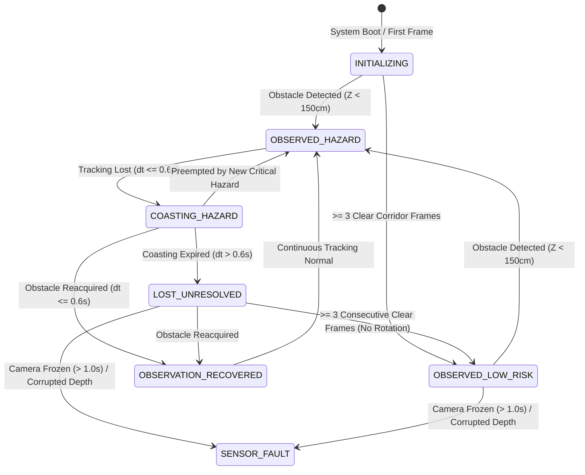

# HORUSEYES 2.0 — PHASE 01B-A++ FINAL SAFETY ARCHITECTURE
**Document ID:** `REPORT-01B-A++-FINAL-SAFETY`  
**Classification:** P0 Safety Integrity & Hazard State Taxonomy  
**Date:** 2026-11-09  

---

## 1. Safety State Taxonomy

HorusEyes 2.0 implements a strict, 6-state hazard tracking taxonomy that enforces scientific integrity and eliminates false assertions of verified clearance.

---

## 2. Core Safety State Definitions

### 2.1. System Startup (`INITIALIZING`)
- **State Semantics:** On application startup (frame 0/1), the system has zero temporal scene history. It initializes perception as `hazard_state = "INITIALIZING"`, `threat_level = "UNKNOWN"`, and `guidance_state = "PATH_UNVERIFIED"`.
- **Audio Output:** Muted (`audio_active = False`).
- **Safety Invariant:** The system **never** reports `SAFE` or `PATH_CLEAR` on boot before sensory evidence has accumulated.

### 2.2. Hazard Observation (`OBSERVED_HAZARD`)
- **Trigger:** An obstacle is extracted from the depth map with $Z < 150\text{ cm}$.
- **Threat Level:**
  - `CRITICAL`: Proximity $Z < 80\text{ cm}$ OR Time-to-Collision $TTC < 1.2\text{ s}$.
  - `WARNING`: $80\text{ cm} \le Z < 150\text{ cm}$ AND $TTC \ge 1.2\text{ s}$ (or stationary).
- **Audio Output:** Active spatial beep (repetition interval $0.08\text{ s}$ to $0.40\text{ s}$, volume 1.0).

### 2.3. Temporal Coasting (`COASTING_HAZARD`)
- **Trigger:** A previously observed hazard momentarily disappears from the camera FOV (e.g., due to hand jitter or pedestrian motion).
- **Duration:** Exactly $0.60\text{ seconds}$ measured by monotonic clock (`elapsed <= 0.60`).
- **Threat Level:** Inherits the prior threat level (`CRITICAL` or `WARNING`). Never downgraded during coasting.
- **Preemption Rule:** If a new critical obstacle is detected during the coasting window, the coasting track is immediately preempted and replaced.

### 2.4. Unresolved Hazard Tracking (`LOST_UNRESOLVED`)
- **Trigger:** Coasting window expires ($dt > 0.60\text{ s}$) without visual reacquisition.
- **Semantics:** Labeled `threat_level = "UNRESOLVED_HAZARD"` and `guidance_state = "PATH_UNRESOLVED"`.
- **Audio Reminder Policy (Task P1-F02):**
  - For $t \le 1.5\text{ s}$ real time since entering lost state: Emits soft `CAUTION_REMINDER` (volume 0.35, low-frequency pulse).
  - For $t > 1.5\text{ s}$ real time: Silences audio to `STANDBY_UNRESOLVED` (volume 0.0) to preserve the user's auditory budget and avoid panic.
  - **Crucial Rule:** Silencing audio **does NOT** downgrade the visual or system state to `SAFE`. The state remains strictly `UNRESOLVED_HAZARD` until affirmative sensory evidence is gathered.

### 2.5. Low-Risk Observation (`OBSERVED_LOW_RISK`)
- **Trigger:** Requires $\ge 3$ consecutive frames satisfying all of the following:
  1. Center corridor distance $Z \ge 200\text{ cm}$.
  2. Left and right sector distances $Z \ge 150\text{ cm}$.
  3. Visual observability verified valid.
  4. Global depth validity ratio $\ge 70\%$ and center validity $\ge 80\%$.
  5. **Camera rotation guard:** The camera is not rotating away ($\Delta pan \le 0.15$ and gyro angular rate $\le 0.30\text{ rad/s}$).
- **Emitted Label:** `NO_HAZARD_DETECTED_IN_OBSERVED_REGION` (replaced the deprecated and unsafe `PATH_CLEAR_CONFIRMED`).
- **Audio Output:** Muted (`audio_active = False`).

### 2.6. Sensor & Pipeline Fault (`SENSOR_FAULT`)
- **Trigger:**
  - Camera frozen $> 1.0\text{ s}$ evaluated via `check_watchdog(now_ts)`.
  - Global NaN/zero ratio $> 30\%$, or center corridor NaN ratio $> 20\%$.
  - Extreme exposure / zero-lux blindness (mean luminance $< 5$ or $> 250$).
- **Action:** Emits distinct `SYSTEM_FAULT` acoustic alert and flags `CAMERA_STALLED` or `VISUAL_EVIDENCE_DEGRADED`. Prevents display of outdated safe states.

---

## 3. Comparison with Deprecated Architectures

| Scenario | Prior Architecture (01B-A) | Corrected Architecture (01B-A++) | Safety Justification |
|---|---|---|---|
| **App Startup** | Emitted `SAFE` immediately. | Emits `INITIALIZING` / `UNKNOWN`. | Cannot certify clear path before receiving scene frames. |
| **Corridor Clear** | Emitted `PATH_CLEAR_CONFIRMED`. | Emits `NO_HAZARD_DETECTED_IN_OBSERVED_REGION`. | Monocular relative depth cannot certify physical metric clearance. |
| **Coasting Expiry** | Reverted to `SAFE` after timer. | Reverts to `LOST_UNRESOLVED` / `PATH_UNRESOLVED`. | Absence of camera view does not mean obstacle vanished. |
| **User Turns Phone** | Cleared hazard after 3 frames of empty wall. | Rotation guard blocks clearing (`is_rotating_away`). | Panning away leaves previous hazard unresolved behind user. |
| **Camera Freezes** | Stale `SAFE` displayed indefinitely. | Watchdog flags `SENSOR_FAULT` within 1.0s. | Prevents blind user walking forward during app freeze. |
| **Reminder Timing** | 20 frames (4.0s @ 5 FPS, 0.67s @ 30 FPS). | 1.5 seconds real time via monotonic clock. | Consistent cognitive load across devices and frame rates. |

---

## 4. Residual Safety Limitations & Boundaries

1. **Monocular Scale Ambiguity:** Distances are pseudo-metric estimates derived via PCHIP spline from MiDaS disparity. They are bounded and monotonic, but have not been calibrated against ground-truth LiDAR across varied focal lengths.
2. **Thin Wires and Overhanging Obstacles:** Objects covering $< 2\%$ of the image plane may be smoothed out during $160 \times 160$ network downsampling.
3. **Severe Lens Glare & Total Darkness:** High specular reflections or pitch-black darkness trigger `SENSOR_FAULT` or `VISUAL_EVIDENCE_DEGRADED`; system does not attempt distance estimation under degraded conditions.
