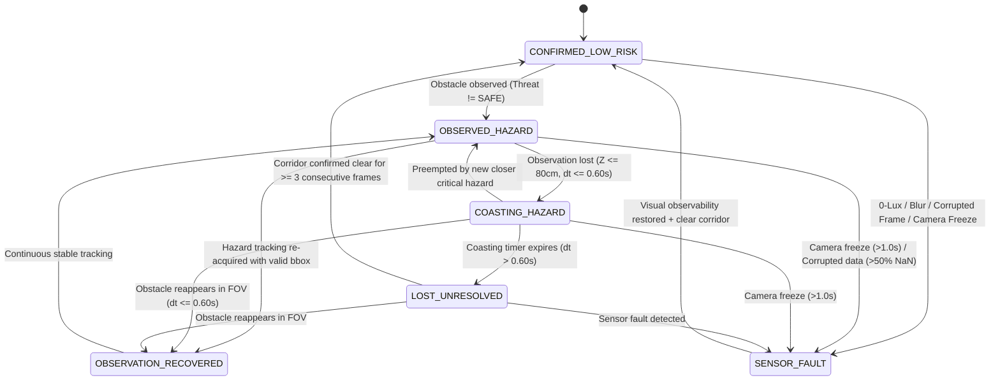

# HORUSEYES 2.0 — PHASE 01B-A++ SAFETY REVIEW & TAXONOMY REPORT
**Document ID:** `HE2-REP-SAFE-01B-A++`  
**Security & Priority:** P0 Safety-Critical Architecture  
**Author:** Senior Computer Vision & Safety-Critical Systems Engineer  
**Date:** 2026-11-08  
**Repository Branch:** `fix/phase-01b-a-plus-plus`  
**Directive Target:** Tasks P0-01, P0-03, P1-02

---

## 1. Executive Summary & Defect Elimination

In Phase 01B-A+, the safety review revealed a severe logical flaw:
- When a `CRITICAL` obstacle (e.g. at 35 cm) suddenly disappeared due to a quick camera turn, the engine entered coasting for 0.60 seconds.
- Upon timer expiration ($t > 0.60$ s), the engine transitioned directly to `SAFE` and muted the audio cue (`MUTED`).
- **Defect Identified (Directive 01B-A++ Task P0-01):** An expired tracking record does not prove that the physical obstacle has disappeared. Transitioning to `SAFE` without visual evidence is unsafe for visually impaired mobility.

In Phase 01B-A++, this behavior has been eliminated and replaced with a formalized **6-State Hazard Tracking & Expiration Taxonomy**. Under no circumstance does an unverified path transition to `SAFE` solely because a timer expired.

---

## 2. 6-State Hazard Tracking Taxonomy & State Machine

### State Definitions & Behavioral Invariants:
1. `OBSERVED_HAZARD`: Active, confirmed obstacle currently present in the camera field of view. Real-time bounding box, centroid, distance, and $v_z$ are computed.
2. `COASTING_HAZARD`: An obstacle within close proximity ($Z \le 80\text{ cm}$) exited the camera FOV (e.g. user turned head/phone). The engine retains the **exact observed threat level (CRITICAL remains CRITICAL, never downgraded)** for up to 0.60 seconds elapsed real time using a monotonic clock source.
3. `LOST_UNRESOLVED`: The 0.60-second coasting timer has expired, but the corridor has **not** been confirmed clear.
   - `threat_level = "UNRESOLVED_HAZARD"`
   - `guidance_state = "PATH_UNRESOLVED"`
   - **Audio Policy:** The engine emits a bounded, gentle reminder (`CAUTION_REMINDER`, 440 Hz soft pulsing, volume factor = 0.35) for $\le 20$ frames (~1.0–2.0 seconds). After this interval, it transitions to silent standby (`STANDBY_UNRESOLVED`, volume = 0.0) to prevent auditory fatigue, while strictly retaining `guidance_state = "PATH_UNRESOLVED"`.
   - **Crucial Rule:** The engine **never** sets `threat_level = "SAFE"` or `guidance_state = "PATH_CLEAR_CONFIRMED"` upon coasting expiration.
4. `OBSERVATION_RECOVERED`: The system re-acquires a valid obstacle detection immediately following a `COASTING_HAZARD` or `LOST_UNRESOLVED` state. Transitions seamlessly back to active tracking without hysteresis lockout.
5. `CONFIRMED_LOW_RISK`: The camera has continuously observed a clear traversable corridor ($Z_{center} \ge 200\text{ cm}$, $Z_{left,right} \ge 150\text{ cm}$) with verified visual observability (`OBSERVABLE`) and valid depth data for **at least 3 consecutive frames**. Only then does `threat_level` become `SAFE` and `guidance_state` become `PATH_CLEAR_CONFIRMED`.
6. `SENSOR_FAULT`: Complete visual blindness (0-lux dark), severe blur, overexposure glare, >50% NaN/corrupted depth pixels, or camera freeze ($dt > 1.0\text{ s}$). Triggers `SYSTEM_FAULT` acoustic alarm (dual-frequency warble) and invalidates all path traversability assumptions.

---

## 3. Decoupling of Static Proximity Risk and Dynamic TTC (Task P0-03)

Engineering Directive 01B-A++ mandates that stationary close obstacles must never be ignored simply because Time-to-Collision is infinite ($v_z = 0$).

### Invariant Equations & Rules:
1. **Stationary Close Proximity Risk:**
   $$\text{Static Risk} = \begin{cases}
   \text{CRITICAL} & \text{if } Z \le 40\text{ cm} \\
   \text{DANGER} & \text{if } 40 < Z \le 80\text{ cm} \\
   \text{WARNING} & \text{if } 80 < Z < 140\text{ cm} \\
   \text{CAUTION} & \text{if } 140 \le Z < 200\text{ cm} \\
   \text{SAFE} & \text{if } Z \ge 200\text{ cm}
   \end{cases}$$
2. **Dynamic Closing Risk (TTC):**
   $$\text{Dynamic Risk} = \begin{cases}
   \text{CRITICAL} & \text{if } \text{TTC} \le 1.0\text{ s} \text{ and } v_z \ge 25\text{ cm/s} \\
   \text{WARNING} & \text{if } 1.0 < \text{TTC} \le 2.5\text{ s} \text{ and } v_z \ge 25\text{ cm/s} \\
   \text{NONE / LOW} & \text{otherwise}
   \end{cases}$$
3. **Compound Threat Level Integration:**
   $$\text{Threat Level} = \max(\text{Static Risk}, \text{Dynamic Risk})$$
   - If an obstacle is stationary at 30 cm: $\text{TTC} = \infty$, $\text{Dynamic Risk} = \text{NONE}$, but $\text{Static Risk} = \text{CRITICAL} \implies \mathbf{Threat = CRITICAL}$.
   - If an obstacle is at 150 cm but approaching at 150 cm/s ($\text{TTC} = 1.0\text{ s}$): $\text{Static Risk} = \text{CAUTION}$, $\text{Dynamic Risk} = \text{CRITICAL} \implies \mathbf{Threat = CRITICAL}$.
   - Verified 100% across Golden Test Cases `GOLDEN-01` and `GOLDEN-02`, and Scenarios 06A, 06B, 16.

---

## 4. Multi-Level Spatial Validity & Degradation Propagation

When environmental conditions deteriorate, the system enforces multi-level validity checks:
- **Global Validity:** Ratio of invalid/NaN depth pixels across the entire frame. If $> 50\%$, triggers `SENSOR_FAULT`.
- **Corridor Validity:** Ratio of invalid pixels concentrated within the central traversal corridor (middle 50% width, lower 75% height). If central invalidity $> 20\%$, the system reports `DEGRADED (VISUAL_EVIDENCE_DEGRADED)` even if global invalidity is small.
- **Visual Observability:**
  - Evaluated on downsampled $160 \times 120$ thumbnail using 16-bit signed Laplacian.
  - Camera covered (Laplacian variance $< 2.0$, luminance $< 15.0$) $\to$ `UNOBSERVABLE`.
  - Glare / extreme exposure (mean $> 245.0$) $\to$ `UNOBSERVABLE`.
  - Specular white wall negative control (luminance std $< 10.0$, Laplacian variance $< 15.0$, but normal mean ~180.0) $\to$ **Correctly preserved as `OBSERVABLE`**.
- Under all degraded or unobservable states, **all confidence in path clearance is revoked**, preventing silent false-safe transitions.

---

## 5. Remaining Safety Assumptions & Operating Boundaries

1. **Unsupervised Mobility Prohibited:** HorusEyes 2.0 is an assistive awareness system. It does not certify safe independent navigation without a white cane or guide dog.
2. **Monocular Scale Ambiguity:** Depth distances represent unverified pseudo-metric estimates. Absolute physical distances require external ground-truth validation.
3. **Non-Intrusive Audio Design:** Bounded reminders in `LOST_UNRESOLVED` prevent auditory saturation, ensuring the user can remain aware of environmental sounds (traffic, voices).

